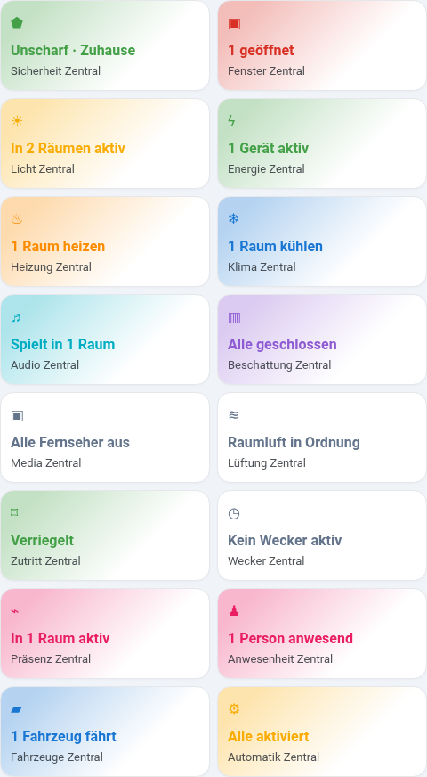

# MYHS Central Card

**MYHS Cards for Home Assistant**

Eine moderne, universelle Dashboard-Karte für [Home Assistant](https://www.home-assistant.io/) mit **16 intelligenten Status-Kacheln**, sanften Farbverläufen und einem vollständig integrierten **visuellen Editor**. Organisiere dein Smart Home in einer übersichtlichen Ansicht – mit deinen eigenen Entitäten, Gruppen und Bereichen.

**Version 1.1.2 · Ohne `custom:button-card` · Home-Assistant-Icons (`mdi:`) · Für helle und dunkle Themes**



> Die Vorschau zeigt Beispielzustände. Die Karte enthält keine fest codierten Entitäts-IDs und ist nicht auf eine bestimmte Home-Assistant-Installation zugeschnitten.

## Highlights

- **16 konfigurierbare Kacheltypen** – unter anderem Sicherheit, Fenster, Licht, Heizung, Medien, Präsenz und Automationen.
- **Visuell konfigurierbar** – Kacheln hinzufügen, entfernen, sortieren, benennen und ein- oder ausblenden; ohne manuelles YAML.
- **Flexible Datenquellen** – automatische Erkennung, eigene Entitäten oder Gruppen/Helfer.
- **Native Home-Assistant-Icons** – `mdi:`-Symbole direkt über den Icon-Picker wählen.
- **Theme-kompatible Farben** – ausschließlich Home-Assistant-Farbvariablen, keine `--custom_*`-Farben.
- **Individuelle Navigation** – pro Kachel ein Dashboard-Ziel oder einen Anker hinterlegen.
- **Anpassbares Layout** – 1 bis 4 Spalten, Abstände und Untertitel nach Bedarf.
- **Reine Statuskarte** – keine unbeabsichtigten Geräte- oder Alarmaktionen beim Antippen.

## Visueller Editor


1. Öffne dein Home-Assistant-Dashboard und wähle **Dashboard bearbeiten**.
2. Klicke auf **Karte hinzufügen** und wähle **MYHS Central Card** aus.
3. Öffne die Einstellungen einer Kachel und wähle Datenquelle, Entitäten, Symbol, Farbe und Navigationsziel.
4. Passe Reihenfolge, Anzahl der Spalten und Abstände an und speichere die Karte.

Alle Einstellungen erfolgen im visuellen Home-Assistant-Karteneditor. YAML ist optional.

## Unterstützte Kacheln

| Kachel | Anzeige | Automatische Erkennung / Datenquelle |
| --- | --- | --- |
| Sicherheit | Zustand der Alarmanlage | `alarm_control_panel` |
| Fenster | Anzahl geöffneter Fenster | `binary_sensor` mit `window` / `opening` |
| Licht | Aktive Leuchten oder Räume | `light` |
| Energie | Eingeschaltete Steckdosen und Geräte | `switch` mit `outlet` / `plug` |
| Heizung | Heizende Räume / Automatikmodus | passende `climate`-Entitäten |
| Klima | Kühlen, Heizen, Lüften | `climate` mit Kühlfunktion |
| Audio | Wiedergabe oder Pause | `media_player` mit `speaker` / `receiver` |
| Beschattung | Offen, geschlossen oder teilweise geöffnet | `cover` |
| Media | Aktive Fernseher | `media_player` mit `tv` |
| Lüftung / Raumluft | Luftqualität oder definierte Abweichungen | ausgewählte Sensoren und Grenzwerte |
| Zutritt | Verriegelt, entriegelt oder blockiert | `lock` |
| Wecker | Aktive Wecker | frei zugeordnete Entitäten |
| Präsenz | Erfasste Bewegung / Anwesenheit | `binary_sensor` mit `motion` / `presence` / `occupancy` |
| Anwesenheit | Anwesende Personen | `person` |
| Fahrzeuge | Fahrzeuge im gewählten Zustand | frei zugeordnete Entitäten |
| Automatik | Aktivierte Automationen | `automation` |

**Hinweis:** Die automatische Erkennung verwendet Home-Assistant-Domänen und Geräteklassen. Geräte ohne passende Geräteklasse können im Editor über **Entitäten auswählen** oder **Gruppe/Helfer verwenden** eingebunden werden. Wenn keine Raumzuordnung vorliegt, kann statt der Raumanzahl die Geräteanzahl erscheinen. Manche Kacheltypen benötigen bewusst eine manuelle Datenquelle.

## Design und Farben

MYHS Central Card verwendet einen **135°-Farbverlauf**, der oben links am stärksten ist und weich ausläuft. Der Verlauf basiert auf der ausgewählten Home-Assistant-Theme-Farbe. Die Kacheln sind auf eine gut lesbare, platzsparende Darstellung ausgelegt.

Verwendet werden unter anderem `--success-color`, `--error-color`, `--warning-color`, `--info-color` sowie weitere Home-Assistant-Palettenfarben. Farben, Icons und Untertitel lassen sich über den Editor anpassen. Zusätzliche Icon-Sets sind nicht erforderlich.

## Installation

### Über HACS / Home Assistant Marketplace

1. Öffne **HACS** bzw. **Marketplace** in Home Assistant.
2. Füge das öffentliche GitHub-Repository als **benutzerdefiniertes Dashboard-Repository** hinzu, sofern es noch nicht im Katalog geführt wird.
3. Installiere **MYHS Central Card** und lade dein Dashboard vollständig neu.
4. Wähle **MYHS Central Card** unter **Dashboard bearbeiten → Karte hinzufügen** aus.

Für die Installation über HACS ist ein öffentliches GitHub-Repository erforderlich; eine ZIP-Datei lässt sich nicht unmittelbar als HACS-Repository importieren.

### Manuelle Installation

1. Kopiere `dist/central-overview-card.js` nach `/config/www/central-overview-card.js` (Ordner gegebenenfalls anlegen).
2. Registriere unter **Einstellungen → Dashboards → Ressourcen** ein **JavaScript-Modul** mit der URL `/local/central-overview-card.js`.
3. Lade das Dashboard neu und füge **MYHS Central Card** im Karteneditor hinzu.

Bei Bedarf muss der erweiterte Modus im Home-Assistant-Profil aktiviert werden, damit die Ressourcenverwaltung sichtbar ist.

## Beispielkonfiguration (optional)

Du kannst die Karte vollständig visuell konfigurieren. Dieses Beispiel zeigt eine reduzierte Ansicht mit drei Kacheln:

```yaml
type: custom:central-overview-card
columns: 2
gap: 8
tiles:
  - kind: windows
    label: Fenster
    source: auto
    tone: error
    navigation_path: '#fenster'
  - kind: lights
    label: Licht
    source: auto
    tone: warning
  - kind: people
    label: Anwesenheit
    source: auto
    tone: pink
```

Ohne eigene `tiles`-Konfiguration zeigt die Karte standardmäßig alle 16 Kacheltypen an.

### Erweiterte Optionen

| Option | Bedeutung |
| --- | --- |
| `tiles[].source` | `auto`, `selected` oder `group` |
| `tiles[].entities` | Liste eigener Entitäts-IDs bei `selected` |
| `tiles[].entity` | Entität einer Gruppe / eines Helfers |
| `tiles[].area` | Bereichsfilter für automatische Erkennung |
| `tiles[].prefix` | Optionaler Entitäts-ID-Präfix |
| `tiles[].automation_entity` | Optionale Automatik-Entität der Beschattung |
| `tiles[].good_states` | Als gut geltende Textzustände bei Raumluft |
| `tiles[].threshold` / `tiles[].comparison` | Grenzwert und Vergleichsrichtung |
| `tiles[].active_state` | Gewünschter Aktivzustand, zum Beispiel bei Fahrzeugen |
| `alarm_home_legacy` | Legacy-Anzeige von `armed_home` als „unscharf“; standardmäßig aus |

**Sicherheit:** `armed_home` bedeutet in Home Assistant „scharf zu Hause“. Die Legacy-Darstellung sollte nur verwendet werden, wenn sie bewusst gewünscht ist. Die Karte dient der **Anzeige und Navigation** und schaltet keine Geräte.

## GitHub-Veröffentlichung

Die Projektdateien gehören direkt ins **Hauptverzeichnis** deines öffentlichen GitHub-Repositories:

```text
.github/workflows/validate.yml
dist/central-overview-card.js
images/preview.png
images/preview-dark.png
images/editor.png
examples/three-tiles.yaml
tests/
hacs.json
README.md
GITHUB-UPLOAD.md
LICENSE
```

Die `hacs.json` muss im Hauptverzeichnis liegen. Für die Veröffentlichung einer bestimmten Version erstelle unter **GitHub → Releases → Draft a new release** einen Release-Tag, zum Beispiel `v1.1.2`, und veröffentliche ihn als reguläres Release.

**GitHub-Beschreibung (About → Description):** `MYHS Cards for Home Assistant`

Die kurze Beschreibung im GitHub-About-Bereich wird **separat auf GitHub** eingestellt. Eine Änderung der `README.md` allein verändert diesen Repository-Beschreibungstext nicht. Auch die in HACS angezeigte Release-Version stammt aus GitHub – nicht aus der Versionsangabe im Karteneditor. Ohne verfügbares Release kann stattdessen eine Git-Commit-Kennung erscheinen.

Weitere Upload-Hinweise findest du in [`GITHUB-UPLOAD.md`](GITHUB-UPLOAD.md).

## Aktualisierung und Cache

Wenn nach einem Update noch die alte Karte angezeigt wird, prüfe zuerst, ob die neue Version wirklich in HACS installiert wurde. Schließe anschließend die Home-Assistant-App vollständig und öffne sie neu. Im visuellen Editor zeigt diese Ausgabe **Version 1.1.2** an.

Bei einer manuellen Installation kann eine neue Ressourcen-URL wie `/local/central-overview-card.js?v=112` helfen, zwischengespeicherte JavaScript-Dateien zu umgehen.

> **Release-Hinweis:** Falls im Repository bereits höhere Tags (z. B. `v1.4.4`) existieren, wird `v1.1.2` unter Umständen nicht als Update erkannt. Plane die Release-Reihenfolge entsprechend. Der technische Kartentyp bleibt für bestehende Dashboards `custom:central-overview-card`.

## Entwicklung und Tests

```bash
node --check dist/central-overview-card.js
node tests/smoke.cjs
# Optional: Browser-Test mit Playwright und Chromium
python tests/browser_smoke.py
```

Syntax, Statuslogik und das Verhalten des visuellen Editors wurden lokal getestet. Die Vorschaubilder zeigen synthetische Daten. Ein Test in einer produktiven Home-Assistant-Installation und der vollständige öffentliche HACS-Veröffentlichungsprozess stehen noch aus.

## Lizenz

MIT – siehe [LICENSE](LICENSE).
