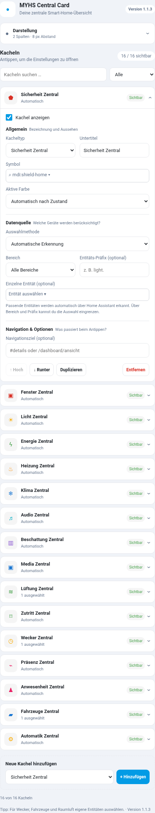

# Central Overview Card – universelle Home-Assistant-Zentralübersicht

Eine eigenständige Lovelace-Karte mit **16 frei konfigurierbaren Status-Kacheln** und **vollständigem visuellem Editor**. Die Karte ist für jede Home-Assistant-Installation gedacht. Sie enthält **keine festen Benutzer- oder Entitäts-IDs** und benötigt **keine `button-card`**.


### Design in v1.4.0 – ursprünglicher Farbverlauf, angenehme Höhe

- Der **ursprüngliche Farbverlauf** ist zurück (135°; HA-Theme-Farbe bei 32 % von 0–14 %, auslaufend bis 68 %), identisch zur v1.2-Darstellung.
- Kachel-Mindesthöhe jetzt **102 px** statt 86 px (v1.3) oder 111 px (v1.2) – ein ausgewogener Mittelweg.
- Icon 25 px, Status 16 px und Untertitel 13 px: wieder besser lesbar.
- Alle **16 Kacheln**, der unveränderte **visuelle Editor** sowie HA-Standardfarben und `mdi:`-Icons bleiben erhalten.
- Bisherige Konfigurationen bleiben kompatibel; keine neuen Pflichtfelder.


## Visuell bearbeiten – direkt im Home-Assistant-Menü



1. Dashboard öffnen → **Dashboard bearbeiten**.
2. **Karte hinzufügen** → **Zentralübersicht (universell)** auswählen.
3. Für eine bestehende Karte **Karte bearbeiten** öffnen.
4. Im **visuellen Menü** die gewünschte Kachel aufklappen. Dort kann man:
   - Kacheltyp wählen, Kacheln **hinzufügen / entfernen / ein- und ausblenden / umsortieren**.
   - **Datenquelle** wählen: automatische Erkennung, ausgewählte Entitäten oder Gruppen/Helfer.
   - Eigene **Entitäten aus dem Home-Assistant-Entitätswähler** zuordnen (auch mehrere).
   - **Bereich** filtern (bei automatischer Erkennung), optional Entitäts-Präfix filtern.
   - **Icon** aus dem **nativen Home-Assistant-Symbolwähler** (`mdi:`), **Beschriftung**, **Navigationsziel** und **aktive Farbe** festlegen.
   - **Spaltenzahl** (1–4), Abstand und die Anzeige von Untertiteln festlegen.
5. **Speichern**. Die Karte erzeugt die Lovelace-Konfiguration selbst – **kein YAML erforderlich**.

### Die 16 Kacheltypen

| Typ | Angezeigter Status | Automatische Erkennung |
| --- | --- | --- |
| Sicherheit | Zustand der Alarmzentrale | `alarm_control_panel` (bei mehreren auswählen) |
| Fenster | Geöffnete Fenster | `binary_sensor` mit `device_class: window/opening` |
| Licht | Aktive Leuchten nach Bereich | `light` |
| Energie | Aktive Steckdosen/Geräte | `switch` mit Geräteklasse `outlet/plug` |
| Heizung | Räume in Heiz-/Auto-Modus | `climate` mit `heat`, ohne `cool` in `hvac_modes` |
| Klima | Kühlen / Heizen / Lüften | `climate` mit `cool` in `hvac_modes` |
| Audio | Wiedergabe/Pause in Räumen | `media_player` mit Geräteklasse `speaker/receiver` |
| Beschattung | Offen, geschlossen, teilweise | `cover`; optionale Automatik-Entität |
| Media | Fernseher an | `media_player` mit Geräteklasse `tv` |
| Lüftung/Raumluft | Räume/Sensoren außerhalb der Grenzwerte | Entitäten auswählen, Grenzwert oder gute Zustände festlegen |
| Zutritt | Tür verriegelt / entriegelt / blockiert | `lock` (bei mehreren auswählen) |
| Wecker | Anzahl aktiver Wecker | Entitäten auswählen |
| Präsenz | Bewegung in Räumen | `binary_sensor` mit `motion/presence/occupancy` |
| Anwesenheit | Personen anwesend | `person` (andere Zonen optional) |
| Fahrzeuge | Fahrzeuge in gewähltem Zustand | Entitäten auswählen, Fahrzustand definieren |
| Automatik | Aktivierte Automationen | `automation` |

**Hinweis zur automatischen Erkennung:** Diese nutzt Home-Assistant-Domänen und Geräteklassen, keine Wörter aus Entitäts-IDs wie `sonos` oder `heizung`. Geräte ohne passende Geräteklasse bitte über **„Entitäten auswählen“** bzw. **„Gruppe / Helfer verwenden“** zuordnen. Automatisch erkannte Aggregat-Entitäten mit `entity_id`-Mitgliedern werden zum Zählen auf ihre Mitglieder aufgelöst. Wenn die Installation keine Geräte-/Bereichszuordnung bietet, wird statt der Anzahl **Räume** ggf. die Anzahl **Geräte** angezeigt.

## Icons aus Home Assistant

Alle 16 Kacheln benutzen ausschließlich **integrierte Material Design Icons** (Präfix `mdi:`), die Home Assistant bereits mitliefert. Im visuellen Editor öffnet der Nutzer pro Kachel den **nativen Home-Assistant-Icon-Picker**, sucht ein Symbol und wählt es aus. Zusätzliche Icon-Sets (`local:`, `hacs:`, Iconify usw.) sind **nicht erforderlich** und werden nicht verwendet. Ist der Icon-Picker in einer älteren Frontend-Version nicht geladen, erscheint als Fallback ein Eingabefeld für `mdi:`-Symbole.

## Farben

Verwendet ausschließlich die **vorhandenen Home-Assistant-Theme-Variablen**: `--success-color`, `--error-color`, `--warning-color`, `--info-color`, `--orange-color`, `--cyan-color`, `--purple-color`, `--pink-color` und weitere Standard-Palettenfarben (`--red-color`, `--green-color`, `--amber-color`, …). **Keine `--custom_*`-Variablen.** Die jeweils aktive Farbe kann im visuellen Editor eingestellt werden. Alarm und Schloss benutzen standardmäßig **zustandsabhängige Farben**. Die Farbverläufe werden per CSS erzeugt, passend zu hellen und dunklen Themes.

## GitHub-Upload (für HACS/Marketplace)

Erstelle auf GitHub ein **öffentliches Repository**, zum Beispiel `lovelace-central-overview-card`. Entpacke die Projekt-ZIP und lade **den Inhalt des Ordners `lovelace-central-overview-card` direkt in das Repository-Hauptverzeichnis** hoch. Nicht das ZIP selbst hochladen und nicht den ganzen Ordner eine Ebene tiefer anlegen.

```text
.github/workflows/validate.yml
dist/central-overview-card.js
images/preview.png
images/editor.png
examples/three-tiles.yaml
tests/browser.html
tests/browser_smoke.py
tests/smoke.cjs
hacs.json
README.md
LICENSE
```

Über **Add file → Upload files → Commit changes** kannst du Dateien hochladen. GitHub lädt versteckte `.github`-Ordner über Drag-and-drop je nach Browser unterschiedlich zuverlässig hoch; kontrolliere, dass `.github/workflows/validate.yml` vorhanden ist. Alternativ lege sie in GitHub per **Add file → Create new file** mit dem Pfad `.github/workflows/validate.yml` an.

Erstelle danach optional unter **Releases → Draft a new release** ein Release, z. B. `v1.4.0`. Dieses ist für die öffentliche Verteilung und Updates sinnvoll. Anschließend das Repository in HACS/Marketplace als benutzerdefiniertes Repository vom Typ **Dashboard** hinzufügen.

## Installation

### Option A – über HACS / Marketplace mit öffentlichem GitHub-Repository

1. Den Inhalt dieses Projektordners in ein **eigenes öffentliches GitHub-Repository** hochladen, z. B. `lovelace-central-overview-card`. Die `hacs.json` muss **im Repository-Hauptverzeichnis** liegen, die JavaScript-Datei in `dist/`.
2. Das Repository in HACS/Marketplace als **benutzerdefiniertes Repository vom Typ Dashboard** hinzufügen. Je nach Home-Assistant-Version heißt der Bereich **HACS** oder **Marketplace**.
3. Die Karte installieren und Home Assistant im Browser neu laden.
4. Die Karte in **Dashboard bearbeiten → Karte hinzufügen** auswählen. Der visuelle Editor ist direkt enthalten.

**Wichtig:** Ein ZIP kann **nicht einfach** in HACS als Repository importiert werden. HACS/Marketplace installieren aus einem GitHub-Repository; das ZIP enthält die Dateien, die man dort hochlädt.

Zur Vorbereitung der öffentlichen Veröffentlichung ist eine GitHub-Action `.github/workflows/validate.yml` enthalten. Eine Aufnahme in den öffentlichen HACS-Katalog muss separat beantragt werden und wird nicht durch das ZIP garantiert.

### Option B – sofort lokal (ohne GitHub)

1. Nur `dist/central-overview-card.js` in Home Assistant nach `/config/www/central-overview-card.js` kopieren (gegebenenfalls `www` anlegen).
2. Unter **Einstellungen → Dashboards → Ressourcen** eine Ressource hinzufügen:
   - URL: `/local/central-overview-card.js`
   - Typ: **JavaScript-Modul**
3. Browser vollständig neu laden und die Karte im visuellen Dashboard-Editor hinzufügen.

Falls der Reiter **Ressourcen** nicht sichtbar ist, muss eventuell der erweiterte Modus im Home-Assistant-Profil aktiviert werden; die genaue Oberfläche kann je nach Version abweichen.

### Mini-YAML-Beispiel (optional, nicht nötig für den Editor)

```yaml
type: custom:central-overview-card
columns: 2
gap: 8
tiles:
  - kind: windows
    label: Fenster
    source: auto
    tone: error
    navigation_path: '#fenster'
  - kind: lights
    label: Licht
    source: auto
    tone: warning
  - kind: people
    label: Zuhause
    source: auto
    tone: pink
```

Die **Standardkonfiguration** enthält automatisch alle 16 Kacheln – mit dem visuellen Editor braucht man nichts von Hand einzutragen.

## Eigenschaften für Fortgeschrittene

- `tiles[].source`: `auto`, `selected`, `group`
- `tiles[].entities`: Array von Entitäts-IDs bei `selected`
- `tiles[].entity`: Gruppen-/Helfer-Entität bei `group`, optional Alarm oder Schloss bei `auto`
- `tiles[].area`: Bereich-ID zum Filtern bei `auto`
- `tiles[].prefix`: optionaler ID-Präfix-Filter bei `auto`
- `tiles[].automation_entity`: Entität der Beschattungsautomatik
- `tiles[].good_states`: erlaubte Textzustände bei der Raumluftkarte, durch Kommata getrennt
- `tiles[].threshold` und `tiles[].comparison`: numerischer Grenzwert (`above` oder `below`)
- `tiles[].active_state`: Bewegungszustand bei Fahrzeugen, z. B. `on` oder `off`
- `alarm_home_legacy`: veraltete Anzeige des Zustands `armed_home` als „unscharf“; **standardmäßig deaktiviert** (Home Assistant interpretiert diesen Zustand als „scharf zu Hause“)

Die Status-Karten sind **nur zur Anzeige und Navigation** gedacht. Ein Klick auf eine Kachel kann zu einer Home-Assistant-Ansicht oder einem Hash-Anker führen; er schaltet keine Geräte oder Sicherheitsfunktionen.

## Tests

```bash
node --check dist/central-overview-card.js
node tests/smoke.cjs
# Zusätzlich optional: Python + Playwright + Chromium
python tests/browser_smoke.py
```

Die Beispielbilder wurden in einem lokalen Browser aus dieser Karte mit **synthetischen Testzuständen** erzeugt. Die JavaScript-Syntax, Zustandsberechnungen und Editor-Ereignisse wurden geprüft. **Nicht** in einer produktiven Home-Assistant-Installation oder über den öffentlichen HACS-Prozess getestet.

## Lizenz

MIT, siehe `LICENSE`.
