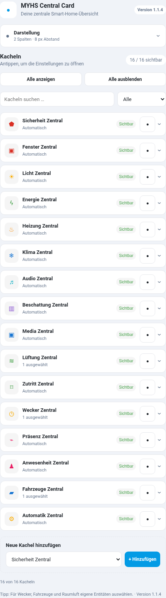

# MYHS Central Card

**MYHS Cards for Home Assistant**

Eine moderne, individuell anpassbare Übersichtskarte für Home Assistant. **MYHS Central Card** bündelt wichtige Informationen zum Smart Home in **16 intelligenten Status-Kacheln** – übersichtlich gestaltet, mit dynamischen Farbverläufen und einem vollständig integrierten **visuellen Editor**.

**Version 1.1.4** · **16 Kacheltypen** · **Visueller Editor** · **Home-Assistant-Icons**


*Die Vorschau zeigt Beispieldaten. Angezeigte Werte und Farben richten sich nach deiner Home-Assistant-Konfiguration.*

## Funktionen

- **Alles auf einen Blick:** Statusinformationen zu Sicherheit, Fenstern, Licht, Klima, Medien, Anwesenheit und weiteren Bereichen.
- **Einfach anpassbar:** Kacheln direkt im Home-Assistant-Menü suchen, hinzufügen, duplizieren, ausblenden, entfernen und neu anordnen.
- **Flexible Datenquellen:** Automatische Erkennung, frei gewählte Entitäten oder Gruppen und Helfer.
- **Passendes Design:** Home-Assistant-Theme-Farben, integrierte Material Design Icons (`mdi:`) und Unterstützung für helle und dunkle Themes.
- **Individuelles Layout:** Ein bis vier Spalten, einstellbare Abstände, Beschriftungen und Navigationsziele.
- **Status und Navigation:** Die Kacheln zeigen Informationen an und können auf Dashboard-Ansichten verlinken. Geräte werden nicht direkt geschaltet.

## Installation

### Über HACS / Home Assistant Marketplace

1. **HACS** beziehungsweise den **Marketplace** in Home Assistant öffnen.
2. Falls die Karte nicht im Katalog verfügbar ist, das GitHub-Repository als **benutzerdefiniertes Dashboard-Repository** hinzufügen.
3. **MYHS Central Card** installieren und die Dashboard-Oberfläche neu laden.
4. Unter **Dashboard bearbeiten → Karte hinzufügen** die **MYHS Central Card** auswählen.

> Für die Installation über HACS wird das GitHub-Repository verwendet, nicht die heruntergeladene ZIP-Datei. Hinweise zur Veröffentlichung findest du unter [GitHub-Einrichtung](GITHUB-UPLOAD.md).

### Manuelle Installation

1. Die Datei `dist/central-overview-card.js` nach `/config/www/central-overview-card.js` kopieren.
2. Unter **Einstellungen → Dashboards → Ressourcen** die URL `/local/central-overview-card.js` als **JavaScript-Modul** hinzufügen.
3. Home Assistant neu laden und die **MYHS Central Card** zum Dashboard hinzufügen.

## Visueller Editor

Die gesamte Konfiguration erfolgt direkt über den Karteneditor in Home Assistant. **YAML ist nicht erforderlich.** Globale Darstellungseinstellungen sind einklappbar; pro Kachel werden nur die gerade benötigten Felder gezeigt.



*Alle Kacheln erscheinen zunächst als kompakte Liste. Ein Klick auf eine Kachel öffnet ihre Einstellungen.*


Unter **Dashboard bearbeiten → Karte bearbeiten** lassen sich:

- Kacheln schnell suchen, nach Sichtbarkeit filtern, einzeln oder gesammelt ein- und ausblenden, hinzufügen, duplizieren, entfernen und umsortieren;
- Kacheltyp und Datenquelle auswählen;
- einzelne Entitäten, Bereiche sowie Gruppen und Helfer zuordnen;
- Namen, `mdi:`-Symbole (über den Symbolwähler **oder per Texteingabe**), Statusfarben und Navigationsziele in getrennten Einstellungsabschnitten ändern;
- Spaltenzahl (1–4), Kachelabstände und Untertitel anpassen.

## Die 16 Kacheltypen

| Kachel | Anzeige | Automatische Datenquelle |
| --- | --- | --- |
| Sicherheit | Zustand der Alarmanlage | `alarm_control_panel` |
| Fenster | Anzahl geöffneter Fenster | `binary_sensor` mit Fenster-/Öffnungsklasse |
| Licht | Eingeschaltete Leuchten oder aktive Räume | `light` |
| Energie | Aktive Steckdosen und Geräte | `switch` mit Steckdosen-Geräteklasse |
| Heizung | Heizen und Automatikbetrieb | Heizungsbezogene `climate`-Entitäten |
| Klima | Kühlen, Heizen und Lüften | Kühlfähige `climate`-Entitäten |
| Audio | Wiedergabe und Pause | `media_player` für Lautsprecher/Receiver |
| Beschattung | Offen, geschlossen oder teilweise geöffnet | `cover` |
| Medien | Aktive Fernseher | `media_player` für Fernseher |
| Raumluft | Sensorwerte oder Grenzwert-Hinweise | Frei wählbare Sensoren |
| Zutritt | Türschlossstatus | `lock` |
| Wecker | Anzahl aktiver Wecker | Frei wählbare Entitäten |
| Präsenz | Erkannte Bewegung oder Präsenz | Passende `binary_sensor`-Geräteklassen |
| Anwesenheit | Anwesende Personen | `person` |
| Fahrzeuge | Fahrzeuge in einem festgelegten Zustand | Frei wählbare Entitäten |
| Automationen | Aktivierte Automationen | `automation` |

**Zur Erkennung:** Die Karte orientiert sich an Home-Assistant-Domänen und Geräteklassen. Geräte ohne passende Zuordnung können im visuellen Editor manuell ausgewählt werden. Für die Kacheln Raumluft, Wecker und Fahrzeuge wird standardmäßig eine passende Datenquelle vom Nutzer festgelegt.

## Konfiguration mit YAML (optional)

Für fortgeschrittene Nutzer ist auch eine manuelle Konfiguration möglich:

```yaml
type: custom:central-overview-card
columns: 2
gap: 8
tiles:
  - kind: windows
    label: Fenster
    source: auto
    tone: error
    navigation_path: '#fenster'
  - kind: lights
    label: Licht
    source: auto
    tone: warning
  - kind: people
    label: Anwesenheit
    source: auto
    tone: pink
```

Ohne eigene `tiles`-Liste werden alle 16 Kacheltypen als Ausgangspunkt angeboten. Für Datenquellen stehen `auto` (automatisch erkennen), `selected` (Entitäten auswählen) und `group` (Gruppe oder Helfer) zur Verfügung. Weitere Optionen betreffen unter anderem Bereichsfilter, Grenzwerte und Navigation.

Der technische Kartentyp lautet weiterhin `custom:central-overview-card`, damit vorhandene Dashboard-Konfigurationen kompatibel bleiben.

## Design und Kompatibilität

- Farbverlauf im **135°-Winkel**, beginnend oben links und sanft auslaufend.
- Verwendung von **Home-Assistant-Standardfarben** und Unterstützung für helle und dunkle Themes.
- Ausschließlich integrierte **Material Design Icons (`mdi:`)**; zusätzliche Symbolpakete sind nicht erforderlich.
- Keine fest hinterlegten persönlichen Entitäts-IDs.

**Hinweis zur Sicherheit:** Der Home-Assistant-Zustand `armed_home` bedeutet „zu Hause scharf“. Die optionale Einstellung `alarm_home_legacy` ist ausschließlich für die Kompatibilität mit früheren Darstellungen vorgesehen und standardmäßig deaktiviert.

## Aktualisierung und Fehlerbehebung

**Änderungen werden nicht angezeigt?** In HACS / Marketplace bei der Karte zunächst **Update information** und danach **Redownload / Aktualisieren** wählen; anschließend die Home-Assistant-App vollständig neu starten. Bei einer manuellen Installation kann die Ressourcen-URL `/local/central-overview-card.js?v=114` helfen, eine zwischengespeicherte Datei zu umgehen.

**In HACS erscheint eine Commit-Kennung statt der Versionsnummer?** Auf GitHub ein **veröffentlichtes reguläres Release** mit dem Tag `v1.1.4` anlegen (ein Tag allein genügt nicht). Die Versionsanzeige in HACS basiert auf den GitHub-Releases; die Versionsangabe im Karteneditor wird von der JavaScript-Datei bereitgestellt. Bereits vorhandene höhere Release-Versionen müssen bei der Versionsplanung berücksichtigt werden.

**Geräte fehlen in der Übersicht?** Geräteklasse und Entitätsdomäne prüfen oder die Entitäten im visuellen Editor gezielt auswählen.

## Entwicklung und Tests

```bash
node --check dist/central-overview-card.js
node tests/smoke.cjs
# Optional: Browsertest mit Playwright und Chromium
python tests/browser_smoke.py
python tests/regression.py
python tests/no_pickers.py
```

JavaScript-Syntax, die 16 Statusberechnungen sowie Sichtbarkeit, Speicherung, manuelle Icons und Entitätsauswahl wurden lokal mit Node.js und Chromium geprüft. Die Tests simulieren Home-Assistant-Ereignisse; reale Integrationen und iOS wurden nicht vollständig verifiziert. Die Vorschaubilder verwenden Beispieldaten. Ein vollständiger Praxistest in einer produktiven Home-Assistant-Installation und die öffentliche HACS-Veröffentlichung stehen noch aus.

## Lizenz

Veröffentlicht unter der [MIT-Lizenz](LICENSE).
